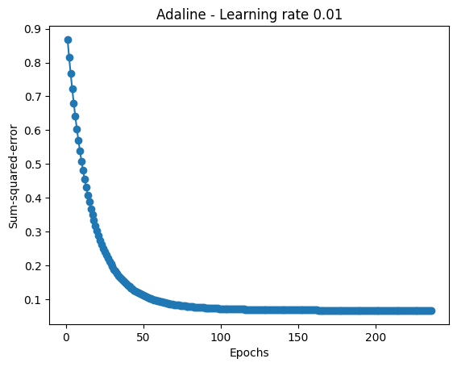
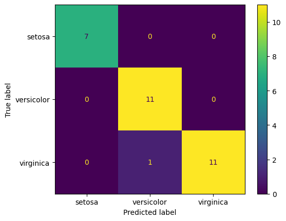
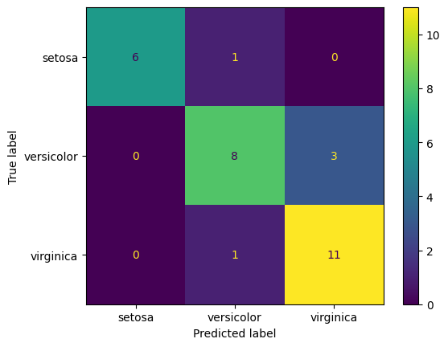
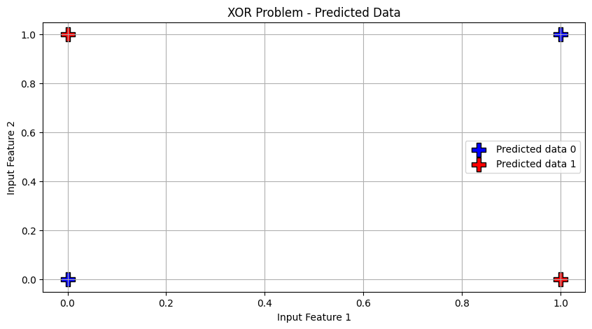

# Soft Computing: Neural Network Exercises

My neural network exercises from the Soft Computing course (HW2) at the University of Kashan.
Sina Mozaffari Rad, student ID 40021160214.

They start with the simplest single-neuron models and end with a small multi-layer network. Everything is
written in PyTorch: I define each model as an `nn.Module` and write the training loop myself (forward pass,
loss, backward pass, optimizer step), with my own stopping rule for convergence. The Iris dataset comes from
scikit-learn, which I also use for splitting, scaling and metrics.

## Theory questions → [`HW2_report.ipynb`](HW2_report.ipynb)

The first part of the homework was written answers, which are in the notebook:

1. Why neural networks need a **bias** and an **activation function**.
2. How the **Adaline** and **perceptron** learning rules differ.
3. How the **Adam** optimizer works, with its update formulas, advantages and disadvantages.

The notebook also has all the code below with explanations and the saved outputs and plots from my Colab run.

## EX4: Loading and splitting the data → [`ex4_iris_data_split.py`](ex4_iris_data_split.py)

- Load the Iris dataset (150 samples, 4 features, 3 classes) and turn it into PyTorch tensors.
- Split it 80 / 20 into training and test sets with a fixed random seed.
- This is the data setup that the next exercises build on.

## EX5: Adaline for two classes → [`ex5_adaline_binary.py`](ex5_adaline_binary.py)

- **Data:** only Setosa and Versicolor, with labels mapped to +1 / −1 and standardised features.
- **Model:** Adaline, a single linear neuron trained on the mean squared error with SGD (learning rate 0.01).
- **Convergence:** training stops when the loss changes by less than 1e-5 between two iterations.
- **Experiments:** I train a separate model on each of the 6 pairs of features, so the decision boundary can
  be drawn in 2-D. The boundary is plotted every 50 iterations while it moves, and again on the training and
  test sets at the end, together with the error curve.

| Feature pair | Train | Test | Stopped at iteration |
|--------------|-------|------|----------------------|
| sepal length, sepal width | 98.8 % | 100 % | 173 |
| sepal length, petal length | 100 % | 100 % | 704 |
| sepal length, petal width | 100 % | 100 % | 631 |
| sepal width, petal length | 100 % | 100 % | 244 |
| sepal width, petal width | 100 % | 100 % | 315 |
| petal length, petal width | 100 % | 100 % | 180 |

Setosa and Versicolor are linearly separable, so a single linear neuron is enough: every pair reaches 100 %
on the test set. The two sepal features are the only pair with a training error, because there the two
classes come close to each other. How fast the loss settles depends a lot on the pair (173 to 704 iterations).
The notebook shows these results as decision-boundary plots; the accuracies in the table come from scoring
the same models on the train and test splits.

<p align="center"></p>

The error curve of the last pair (petal length and petal width): the loss falls quickly in the first 50
epochs and then flattens, and training stops by itself after about 240 epochs.

## EX6: Perceptron vs. Adaline on all three classes → [`ex6_perceptron_vs_adaline.py`](ex6_perceptron_vs_adaline.py)

- **Data:** all 4 features and all 3 classes, standardised.
- **Perceptron:** one linear layer with 3 outputs, trained with cross-entropy loss. It stops early as soon as
  no training sample is misclassified.
- **Adaline:** the same layer, trained on the MSE against one-hot targets, with the same loss-change stopping
  rule as in EX5.
- **Evaluation:** 5-fold cross-validation for both models, average test accuracy, and a confusion matrix.

| Model | Fold accuracies | Average |
|-------|-----------------|---------|
| Perceptron | 100, 93.3, 93.3, 90.0, 96.7 % | **95 %** |
| Adaline | 83.3, 80.0, 86.7, 80.0, 83.3 % | 83 % |

These are the results saved in the notebook. The weights start at random values, so Adaline's numbers move
a few percent between runs; the perceptron gave the same 95 % every time I ran it.

<table align="center"><tr>
<td align="center"><br>Perceptron</td>
<td align="center"><br>Adaline</td>
</tr></table>

Confusion matrices on the test set of the last fold.

Versicolor and Virginica overlap, so they are not linearly separable, and that is where the mistakes are.
The perceptron does clearly better. Adaline fits one-hot targets with squared error, which is not the same as
getting the class right, and its stopping rule ends training as soon as the loss flattens.

## EX7: Multi-layer network for XOR → [`ex7_xor_mlp.py`](ex7_xor_mlp.py)

- **Problem:** XOR, the classic example that a single neuron cannot solve, because no straight line splits
  the two classes.
- **Model:** 2 → 4 → 4 → 1 with ReLU in the hidden layers and a sigmoid output.
- **Training:** binary cross-entropy and the Adam optimizer (learning rate 0.01) for 20,000 epochs, printing
  the loss every 1,000 epochs.
- **Output:** rounded predictions compared with the expected outputs, and plots of the real and predicted
  classes.

The hidden layers let the network bend the input space, so after training it gives the correct output for
all four inputs (final loss 0.0000). This is the main difference from EX5 and EX6, where the models can only draw straight lines.

<p align="center"></p>

## Files

```
HW2_report.ipynb                Theory answers + all exercises with outputs (Colab)
ex4_iris_data_split.py          Iris loading and train/test split
ex5_adaline_binary.py           Adaline, two classes, every pair of features
ex6_perceptron_vs_adaline.py    Perceptron and Adaline, three classes, 5-fold CV
ex7_xor_mlp.py                  Two-hidden-layer network for XOR
docs/                           Plots from the notebook used in this README
```

## Running

The Iris dataset is built into scikit-learn, so nothing has to be downloaded.

```bash
pip install torch scikit-learn matplotlib numpy
python ex7_xor_mlp.py
```
